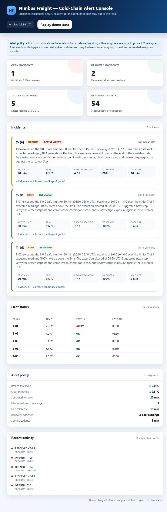

# Nimbus Freight Cold-Chain Alerting

A runnable cold-chain alerting engine for Nimbus Freight's reefer fleet. It ingests
temperature readings, detects **sustained** excursions per truck, suppresses brief
blips, and emits **one alert per incident** instead of re-alerting every few minutes.

The implementation includes a deterministic detection engine, a SQLite-backed
idempotent ingest pipeline, a FastAPI service, an ops dashboard, tests, and a
Docker deployment.

The deliberately open questions — what counts as too warm, how long is too long,
and what to do when data has gaps or arrives out of order — are decided and
documented in **[DECISIONS.md](DECISIONS.md)**. The short version is below; the
decision register contains the rationale, edge cases, configuration knobs, and
open items for customer sign-off.



---

## The alert rule in one paragraph

A truck starts an excursion when a reading is above **8.0 C**. It becomes an alert
only when the episode is sustained for at least **20 minutes**, contains at least
**3 breach readings**, and has enough real data to prove continuity: at least
**50% coverage** of the expected 5-minute samples and no gap larger than
**15 minutes** before the alert fires. The incident resolves after **2 consecutive
readings at or below 7.5 C**. The gap between 7.5 C and 8.0 C is deliberate
hysteresis, so a temperature hovering at the limit does not flap between open and
resolved. One incident produces one opening event and at most one resolution
event, no matter how many readings arrive. The full decision register is in
[DECISIONS.md](DECISIONS.md).

---

## Quick start (local)

Requires Python 3.10+.

```powershell
py -3.12 -m venv .venv
.\.venv\Scripts\Activate.ps1
pip install -r requirements-dev.txt
pip install -e .

# Replay the provided dataset end-to-end
coldchain replay --reset --data data/sensor_readings.json

# See how incident counts move if the threshold or sustained window changes
coldchain what-if --data data/sensor_readings.json

# Run the API + dashboard with the demo dataset seeded on first boot
coldchain serve --demo --port 8000
```

Open <http://localhost:8000> for the dashboard and <http://localhost:8000/docs>
for the OpenAPI docs.

On macOS/Linux, activate with `source .venv/bin/activate` and use forward slashes.
If you do not want to install the package, prefix commands with
`PYTHONPATH=src`/`$env:PYTHONPATH="src"` and run `python -m coldchain ...`.

## Quick start (Docker)

```bash
docker compose up --build -d
docker compose logs -f coldchain
```

The service is at <http://localhost:8000>. The SQLite database is kept in the
`coldchain-state` volume. The container seeds the provided dataset on first boot
and enables the dashboard's **Replay demo data** button. The image also has a
health check against `GET /healthz`.

Stop it with `docker compose down`; add `-v` to remove the demo database.

---

## Expected result on the provided dataset

`coldchain replay --reset` produces:

| Truck | Outcome | Why |
|---|---|---|
| **T-01** | **Alert, resolved** | 30 minutes above 8.0 C, peak 9.6 C, 7/7 expected readings, cleared at 08:50. |
| **T-02** | Suppressed | One 8.9 C spike; back to 6.5 C five minutes later. |
| **T-03** | No breach | Peak 7.0 C. |
| **T-04** | **Alert, still open** | Two short blips are suppressed; the sustained run from 08:25-08:45 is 20 minutes, with a 10-minute sensor gap (one missing reading) inside it. |
| **T-05** | **Alert, resolved** | Same shape as T-01, but its readings arrive out of order. The engine sorts by event time before evaluating. |

Result: **3 sustained incidents, 2 suppressed blips, 1 quiet truck.** Running the
same replay again without `--reset` produces **0 new events**, demonstrating
deduplication and idempotent ingest.

The replay also prints a **DATA QUALITY** section for the same dataset: 54
readings, 54 unique timestamps, 5 out-of-order readings (all T-05), 0 duplicate
timestamps, 1 missing expected sample and one 10-minute gap within tolerance
(T-04), and 0 gaps over tolerance. This is the evidence the engine repaired
before evaluating; it is also available as `analysis.data_quality` in JSON.

---

## How it works

```
sensor readings
      |
      v
POST /api/v1/readings[/batch]  or  coldchain replay
      |
      v
SQLite readings (truck_id, timestamp)  <-- upsert = retries are safe
      |
      v
per-truck recomputation (event-time sorted, duplicate timestamps collapsed)
      |
      v
state machine: PENDING -> ACTIVE -> RESOLVED
      |
      v
incidents + deduplicated alert_events  --> dashboard / API / optional webhook
```

Key design choices:

- **Event time, not arrival time.** Every truck's readings are sorted and
  deduplicated before evaluation. T-05 proves why this matters.
- **Sustained evidence, not a single reading.** Duration alone is not enough;
  the engine also requires a minimum number of breach readings and adequate
  coverage so a sparse, gappy stream cannot fabricate a sustained incident.
- **Bounded gap tolerance.** A single missed 5-minute reading is tolerated.
  A gap beyond 15 minutes breaks a *pending* run because continuity cannot be
  proven. Once an alert is active, missing data does **not** silently resolve it;
  the gap is recorded and recovery evidence is required after connectivity returns.
- **Hysteresis + recovery evidence.** Active incidents survive readings in the
  7.5-8.0 C band and resolve only after two readings at or below 7.5 C.
- **Deterministic incident identity.** `incident_id = hash(truck_id + episode start)`.
  Recomputing a truck after a late/out-of-order reading updates the same incident.
  `alert_events` has a unique `(incident_id, event_type)` constraint, so the same
  incident cannot re-alert on replay.
- **Separation of concerns.** `engine.py` is pure and easy to test; `store.py`
  owns durability and deduplication; `pipeline.py` orchestrates; `api.py` is a
  thin HTTP layer.
- **Decisions are explicit.** Threshold, duration, evidence density, gap
  tolerance, recovery rule, ordering, and duplicate handling are all policy
  fields, not hidden constants. [DECISIONS.md](DECISIONS.md) records why each
  default exists and what remains for customer sign-off.

### Policy decisions and sensitivity

Threshold and duration are commercial risk decisions, so the repository does not
pretend they are self-evident. [DECISIONS.md](DECISIONS.md) is the decision
register; `coldchain what-if` makes the trade-off visible on the actual dataset:

```bash
coldchain what-if --data data/sensor_readings.json
coldchain what-if --thresholds 7.5,8,8.5 --durations 15,20,25 --format json
```

The command sweeps breach threshold × sustained window, prints incident counts
in a grid, and lists which trucks appear in each combination. It is read-only and
does not change configuration.

---

## API

### Ingest one reading

```bash
curl -X POST http://localhost:8000/api/v1/readings \
  -H "Content-Type: application/json" \
  -d '{"truck_id":"T-01","timestamp":"2026-07-20T09:00:00Z","temperature_c":9.2,"humidity_pct":58}'
```

### Ingest a batch

```bash
curl -X POST http://localhost:8000/api/v1/readings/batch \
  -H "Content-Type: application/json" \
  -d '{"readings":[{"truck_id":"T-01","timestamp":"2026-07-20T09:05:00Z","temperature_c":9.4}]}'
```

### Read the alert feed

```bash
curl "http://localhost:8000/api/v1/alerts?status=open"
curl "http://localhost:8000/api/v1/incidents?status=all"
curl "http://localhost:8000/api/v1/incidents/INC-XXXXXXXXXXXX"
curl "http://localhost:8000/api/v1/trucks"
curl "http://localhost:8000/api/v1/stats"
```

### Dashboard data and demo replay

```bash
curl "http://localhost:8000/api/v1/dashboard"
curl -X POST "http://localhost:8000/api/v1/demo/replay?reset=true"
```

Demo replay is disabled unless `COLDCHAIN_DEMO_MODE=true`.

---

## Configuration

Defaults live in `Policy` in `src/coldchain/config.py` and map one-to-one to the
decisions in [DECISIONS.md](DECISIONS.md). They can be changed with environment
variables:

| Variable | Default | Meaning |
|---|---:|---|
| `COLDCHAIN_THRESHOLD_C` | `8.0` | Breach threshold |
| `COLDCHAIN_CLEAR_THRESHOLD_C` | `7.5` | Recovery threshold (hysteresis) |
| `COLDCHAIN_MIN_DURATION_MIN` | `20` | Minimum sustained window |
| `COLDCHAIN_MIN_BREACH_READINGS` | `3` | Minimum real breach samples |
| `COLDCHAIN_MAX_GAP_MIN` | `15` | Maximum tolerated data gap |
| `COLDCHAIN_RECOVERY_READINGS` | `2` | Consecutive clear readings to resolve |
| `COLDCHAIN_NOMINAL_INTERVAL_MIN` | `5` | Expected sample cadence |
| `COLDCHAIN_MIN_COVERAGE` | `0.5` | Required breach-sample coverage |
| `COLDCHAIN_DB` | `data/coldchain.db` | SQLite path |
| `COLDCHAIN_DATASET` | `data/sensor_readings.json` | Demo/replay dataset |
| `COLDCHAIN_SEED_DEMO` | `false` | Seed dataset when DB is empty |
| `COLDCHAIN_DEMO_MODE` | `false` | Enable replay endpoint/button |
| `COLDCHAIN_WEBHOOK_URL` | unset | Slack-compatible webhook for OPENED/RESOLVED |

For per-truck or per-cargo rules, copy `config/policy.example.json` and set
`COLDCHAIN_POLICY_FILE`. Example:

```json
{
  "default": { "threshold_c": 8.0, "min_duration_minutes": 20 },
  "trucks": {
    "T-04": { "min_duration_minutes": 25 }
  }
}
```

The JSON can also override any field in the table above under `default` or per
truck.

### Optional LLM summaries (bonus track)

A deterministic template summary is always generated. To enable an LLM rewrite:

```bash
export COLDCHAIN_LLM_ENABLED=true
export OPENAI_API_KEY=sk-...
# optional: export COLDCHAIN_LLM_MODEL=gpt-4o-mini
```

Failures or missing credentials fall back to the template; the alert pipeline does
not depend on an external model being available.

---

## Tests

```bash
pytest -q
# or, without pytest:
python run_tests.py
```

The suite covers the golden dataset, out-of-order readings, missing readings,
large gaps on pending vs. active incidents, sparse samples, hysteresis, recovery,
per-truck policy overrides, idempotent replay, late-arriving ingest, summary
content, the data-quality report (gaps, duplicates, out-of-order counts), the
what-if sweep, and the API/demo endpoints.

---

## Project layout

```
coldchain/
  src/coldchain/
    engine.py       pure sustained-excursion state machine
    quality.py      gap / duplicate / out-of-order data-quality report
    store.py        SQLite persistence + alert-event deduplication
    pipeline.py     ingest/recompute/replay orchestration
    api.py          FastAPI service + dashboard data endpoints
    cli.py          replay / alerts / stats / what-if / serve
    summarizer.py   deterministic + optional LLM summaries
    static/         single-page ops dashboard
  data/sensor_readings.json
  tests/
  Dockerfile
  docker-compose.yml
  DECISIONS.md
  SOLUTION_DESIGN.md
```

`starter_kit/` is left untouched; its dataset was copied to `data/` so the app is
self-contained. The starter utility's assumptions are intentionally not used:
it assumes sorted input and a fixed 5-minute cadence with no gaps, both of which
are false in the provided data.

---

## Known limitations / next steps

- **Single-node SQLite.** Fine for a case-study demo and a moderate fleet; a
  production fleet should use a managed event store/stream (Kafka/Kinesis) and a
  time-series database, with per-truck ordered processing or event-time windows.
- **No cargo metadata in the seed data.** The default 8.0 C policy is a reasonable
  pharma/grocery cold-chain assumption, but real deployments need per-cargo or
  per-customer setpoints. The policy file already supports per-truck overrides.
- **No sensor-health alerting.** A truck that stops reporting entirely currently
  keeps an active incident open and records gaps, but does not raise a separate
  "sensor offline" alert. That is the next reliability feature.
- **Recompute-on-ingest.** For this dataset size, recomputing a truck when a late
  reading arrives is simple and correct. At very high throughput, use watermarks
  and incremental state.
- **No authentication / acknowledgement workflow.** The API is intended to sit
  behind the customer's gateway. Alert acknowledgement, assignment, and escalation
  are product features for v2.
- **Webhook is best-effort.** Notification failures are logged and do not fail
  ingestion; a production integration would add a durable outbox and retries.
