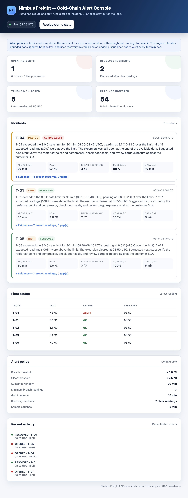

# Execution evidence

Reproducible run of the submitted solution in this repository. All commands were
run from the repository root in a `python:3.12-slim` container with the working
directory mounted at `/app` (Docker Desktop 29.9.2 on macOS arm64).

Date: 2026-11-16 (UTC 2026-11-17).

## 1. Test suite

```bash
docker run --rm -v "$PWD":/app -w /app python:3.12-slim sh -c \
  "pip install -q -r requirements-dev.txt && pip install -q -e . && pytest -q"
```

```
23 passed, 1 warning in 0.45s
```

## 2. Replay the provided dataset

```bash
docker run --rm -v "$PWD":/app -w /app python:3.12-slim sh -c \
  "pip install -q -r requirements.txt && pip install -q -e . && \
   COLDCHAIN_DB=/tmp/demo.db coldchain replay --reset --data data/sensor_readings.json"
```

```
Nimbus Freight cold-chain replay
Dataset: data/sensor_readings.json
Readings: 54 across 5 trucks
Policy: >8.0 C breach; <= 7.5 C clear; sustained >= 20 min; >= 3 breach readings; gap tolerance 15 min; recover after 2 clear readings

DATA QUALITY
------------------------------------------------------------------------------
54 readings, 54 unique timestamps | 5 out of order | 0 duplicate timestamps collapsed | 1 missing expected samples | 0 gap(s) over tolerance
- T-04: 1 missing sample(s); gaps: 10 min (within tolerance)
- T-05: 5 out-of-order reading(s)

SUSTAINED INCIDENTS (3)
------------------------------------------------------------------------------
[1] T-01  HIGH     RESOLVED 08:10-08:40 UTC (30 min)
    peak 9.6 C | 7/7 expected breach readings (100% coverage) | max gap 5 min

[2] T-05  HIGH     RESOLVED 08:10-08:40 UTC (30 min)
    peak 9.6 C | 7/7 expected breach readings (100% coverage) | max gap 5 min

[3] T-04  MEDIUM   OPEN     08:25-08:45 UTC (20 min)
    peak 9.1 C | 4/5 expected breach readings (80% coverage) | max gap 10 min

SUPPRESSED NOISE (2)
------------------------------------------------------------------------------
- T-04  08:05-08:10 UTC  (5 min, 2 breach reading(s), peak 8.6 C)
  reason: temperature returned to <= 7.5 C before the 20-minute sustained threshold was met
- T-02  08:10-08:10 UTC  (0 min, 1 breach reading(s), peak 8.9 C)
  reason: temperature returned to <= 7.5 C before the 20-minute sustained threshold was met

NO THRESHOLD BREACH: T-03

ALERT LIFECYCLE
------------------------------------------------------------------------------
New events on this ingest: 3 opened, 2 resolved, 0 superseded
Database: /tmp/demo.db | incidents=1 open, 2 resolved
```

## 3. Idempotency: replay again against the same database

```bash
COLDCHAIN_DB=/tmp/idem.db coldchain replay --reset --data data/sensor_readings.json
COLDCHAIN_DB=/tmp/idem.db coldchain replay --data data/sensor_readings.json
```

```
--- same DB, second replay ---
New events on this ingest: 0 opened, 0 resolved, 0 superseded
No new events: idempotent replay; these incidents were already recorded.
```

## 4. Live service

```bash
coldchain serve --demo --port 8000
```

The container was published on host port 8010 for this run.

```
GET /healthz
{"status":"ok","readings":54,"open_incidents":1}

GET /api/v1/stats
{"readings":54,"trucks":5,"open_incidents":1,"resolved_incidents":2,
 "critical_open":0,"alert_events":5,"last_reading_at":"2026-07-20T08:50:00Z"}

GET /api/v1/trucks
T-01  OK      latest 7.0 C   resolved 1
T-02  OK      latest 6.1 C   resolved 0
T-03  OK      latest 6.1 C   resolved 0
T-04  ALERT   latest 7.2 C   open INC-0372062EA4B3 (MEDIUM, since 08:25)
T-05  OK      latest 7.0 C   resolved 1

GET /api/v1/incidents?status=all
INC-0372062EA4B3  T-04  OPEN      MEDIUM  peak 9.1 C  4 breaches  80% coverage
INC-5DDB5E2528A2  T-01  RESOLVED  HIGH    peak 9.6 C  7 breaches  100% coverage
INC-F029127F73C7  T-05  RESOLVED  HIGH    peak 9.6 C  7 breaches  100% coverage

GET /api/v1/events
OPENED   T-01  08:30
RESOLVED T-01  08:50
OPENED   T-04  08:45
OPENED   T-05  08:30
RESOLVED T-05  08:50
```

## 5. Dashboard

The single-page dashboard was opened at `http://localhost:8010/`; the browser
reported no console errors. Clicking **Replay demo data** issued
`POST /api/v1/demo/replay?reset=true` and rebuilt the same state (still 5 alert
events), confirming the UI path.



## 6. Cleanup

```bash
docker rm -f coldchain-demo
```
